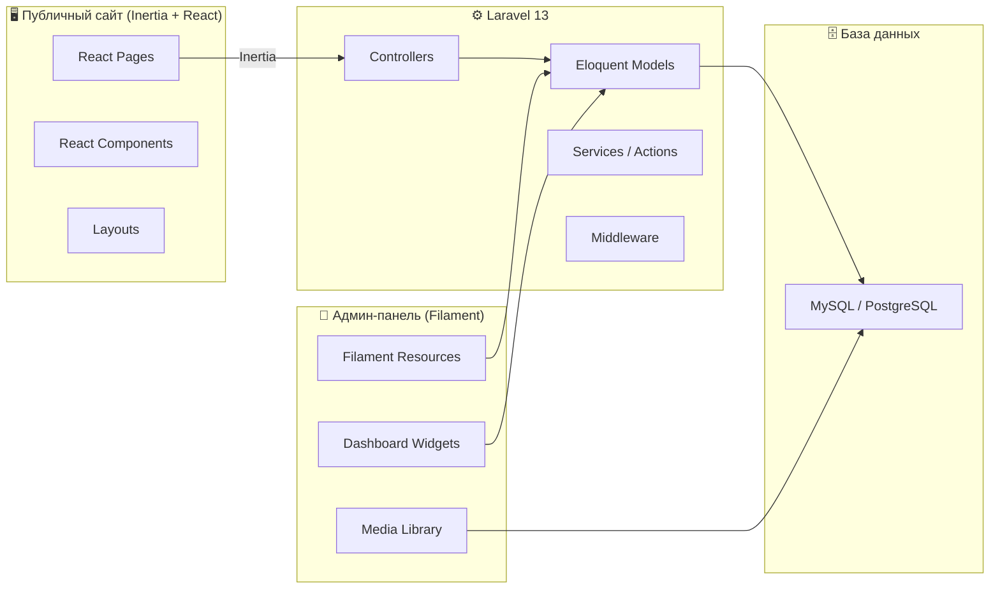

# 🏟️ Paksi FC — Детальный план разработки сайта

> **Стек:** Laravel 13 + Filament (Admin) + Inertia.js + React 19 + Tailwind CSS 4  
> **Язык сайта:** Венгерский (hu)  
> **Текущее состояние:** Чистый Laravel React Starter Kit с базовой авторизацией

---

## 📐 1. Архитектура проекта



### Почему Filament, а не своя админка?

| Критерий | Filament | Своя админка (Inertia+React) |
|---|---|---|
| Скорость разработки | ⚡ ~2-3x быстрее | 🐌 Много boilerplate |
| WYSIWYG редактор | ✅ Встроенный (Tiptap) | ❌ Нужно интегрировать |
| Загрузка медиа | ✅ Spatie Media Library | ❌ Писать с нуля |
| Роли/разрешения | ✅ Filament Shield | ❌ Писать с нуля |
| UI компоненты | ✅ 50+ готовых | ❌ Писать с нуля |
| Изоляция от фронтенда | ✅ Отдельный `/admin` | ❌ Общий код |

> [!IMPORTANT]
> Filament работает на Livewire/Alpine.js и полностью изолирован от React-фронтенда. Админка живёт на `/admin`, публичный сайт — на `/`. Конфликтов нет.

---

## 📁 2. Структура базы данных

### 2.1 Новости (`articles`)

| Поле | Тип | Описание |
|---|---|---|
| `id` | `bigIncrements` | PK |
| `title` | `string(255)` | Заголовок новости |
| `slug` | `string(255)` | URL-friendly slug, unique |
| `excerpt` | `text`, nullable | Краткое описание (для карточек) |
| `content` | `longText` | Полный текст (HTML из WYSIWYG) |
| `featured_image` | `string`, nullable | Путь к главному изображению |
| `category_id` | `foreignId` | FK → `article_categories` |
| `author_id` | `foreignId` | FK → `users` |
| `status` | `enum('draft','published','archived')` | Статус публикации |
| `is_featured` | `boolean`, default false | Показывать в слайдере на главной |
| `is_pinned` | `boolean`, default false | Закреплённая новость |
| `published_at` | `timestamp`, nullable | Дата публикации (для отложенной публикации) |
| `views_count` | `unsignedInteger`, default 0 | Счётчик просмотров |
| `meta_title` | `string(255)`, nullable | SEO: title |
| `meta_description` | `text`, nullable | SEO: description |
| `created_at` | `timestamp` | — |
| `updated_at` | `timestamp` | — |

### 2.2 Категории новостей (`article_categories`)

| Поле | Тип | Описание |
|---|---|---|
| `id` | `bigIncrements` | PK |
| `name` | `string(100)` | Название (напр. "Mérkőzés beszámoló", "Átigazolás", "Akadémia") |
| `slug` | `string(100)` | URL-slug, unique |
| `description` | `text`, nullable | Описание категории |
| `color` | `string(7)`, nullable | Цвет метки (#HEX) |
| `sort_order` | `integer`, default 0 | Порядок сортировки |
| `is_active` | `boolean`, default true | Активна ли |
| `created_at` | `timestamp` | — |
| `updated_at` | `timestamp` | — |

**Предлагаемые категории по умолчанию:**
- `Mérkőzés` — Матчевые отчёты
- `Átigazolás` — Трансферные новости
- `Sajtó` — Пресс-конференции
- `Akadémia` — Новости академии
- `Klub hírek` — Клубные новости
- `Szurkolói hírek` — Фанатские новости

### 2.3 Теги новостей (`tags` + `article_tag`)

**`tags`:**

| Поле | Тип | Описание |
|---|---|---|
| `id` | `bigIncrements` | PK |
| `name` | `string(50)` | Название тега |
| `slug` | `string(50)` | URL-slug, unique |

**`article_tag`** (pivot):

| Поле | Тип |
|---|---|
| `article_id` | `foreignId` |
| `tag_id` | `foreignId` |

### 2.4 Статические страницы (`pages`)

| Поле | Тип | Описание |
|---|---|---|
| `id` | `bigIncrements` | PK |
| `title` | `string(255)` | Заголовок |
| `slug` | `string(255)` | URL-путь, unique |
| `content` | `longText` | HTML-контент (WYSIWYG) |
| `featured_image` | `string`, nullable | Обложка |
| `parent_id` | `foreignId`, nullable | FK → `pages` (вложенность) |
| `sort_order` | `integer`, default 0 | Порядок в меню |
| `is_published` | `boolean`, default false | Опубликована ли |
| `template` | `string(50)`, default 'default' | Шаблон (`default`, `contact`, `stadium`, `history`) |
| `meta_title` | `string`, nullable | SEO |
| `meta_description` | `text`, nullable | SEO |
| `created_at` | `timestamp` | — |
| `updated_at` | `timestamp` | — |

### 2.5 Команда — Игроки (`players`)

| Поле | Тип | Описание |
|---|---|---|
| `id` | `bigIncrements` | PK |
| `first_name` | `string(100)` | Имя |
| `last_name` | `string(100)` | Фамилия |
| `slug` | `string(200)` | URL-slug, unique |
| `squad_number` | `unsignedTinyInteger`, nullable | Номер на футболке |
| `position` | `enum('goalkeeper','defender','midfielder','forward')` | Позиция |
| `date_of_birth` | `date`, nullable | Дата рождения |
| `nationality` | `string(100)` | Гражданство |
| `height` | `unsignedSmallInteger`, nullable | Рост (см) |
| `weight` | `unsignedSmallInteger`, nullable | Вес (кг) |
| `preferred_foot` | `enum('left','right','both')`, nullable | Рабочая нога |
| `photo` | `string`, nullable | Фото игрока |
| `biography` | `text`, nullable | Биография |
| `joined_at` | `date`, nullable | Дата прихода в клуб |
| `contract_until` | `date`, nullable | Контракт до |
| `previous_clubs` | `json`, nullable | Предыдущие клубы `[{name, years}]` |
| `is_active` | `boolean`, default true | В текущем составе |
| `team_id` | `foreignId` | FK → `teams` |
| `sort_order` | `integer`, default 0 | Порядок внутри позиции |
| `created_at` | `timestamp` | — |
| `updated_at` | `timestamp` | — |

### 2.6 Команды (`teams`)

| Поле | Тип | Описание |
|---|---|---|
| `id` | `bigIncrements` | PK |
| `name` | `string(100)` | Напр. "Első csapat", "U21", "U19", "U17" |
| `slug` | `string(100)` | URL-slug |
| `description` | `text`, nullable | Описание |
| `sort_order` | `integer` | Порядок |
| `is_active` | `boolean`, default true | — |

### 2.7 Тренерский штаб (`staff`)

| Поле | Тип | Описание |
|---|---|---|
| `id` | `bigIncrements` | PK |
| `first_name` | `string(100)` | Имя |
| `last_name` | `string(100)` | Фамилия |
| `slug` | `string(200)` | URL-slug |
| `role` | `string(100)` | Должность (Vezetőedző, Másodedző, Kapusedző...) |
| `photo` | `string`, nullable | Фото |
| `biography` | `text`, nullable | Биография |
| `team_id` | `foreignId` | FK → `teams` |
| `sort_order` | `integer`, default 0 | — |
| `is_active` | `boolean`, default true | — |

### 2.8 Сезоны (`seasons`)

| Поле | Тип | Описание |
|---|---|---|
| `id` | `bigIncrements` | PK |
| `name` | `string(20)` | Напр. "2026/2027" |
| `start_date` | `date` | Начало сезона |
| `end_date` | `date` | Конец сезона |
| `is_current` | `boolean`, default false | Текущий сезон |

### 2.9 Соревнования (`competitions`)

| Поле | Тип | Описание |
|---|---|---|
| `id` | `bigIncrements` | PK |
| `name` | `string(100)` | Напр. "NB I", "Magyar Kupa", "Európa Liga" |
| `slug` | `string(100)` | URL-slug |
| `short_name` | `string(20)` | "NB I", "MK" |
| `logo` | `string`, nullable | Логотип турнира |
| `sort_order` | `integer` | — |

### 2.10 Матчи (`matches`)

| Поле | Тип | Описание |
|---|---|---|
| `id` | `bigIncrements` | PK |
| `season_id` | `foreignId` | FK → `seasons` |
| `competition_id` | `foreignId` | FK → `competitions` |
| `round` | `string(50)`, nullable | Тур / Раунд ("12. forduló", "Negyeddöntő") |
| `match_date` | `datetime` | Дата и время |
| `venue` | `string(200)`, nullable | Стадион |
| `is_home` | `boolean` | Домашний матч? |
| `opponent_name` | `string(200)` | Название соперника |
| `opponent_logo` | `string`, nullable | Логотип соперника |
| `home_score` | `unsignedTinyInteger`, nullable | Голы хозяев |
| `away_score` | `unsignedTinyInteger`, nullable | Голы гостей |
| `status` | `enum('scheduled','live','finished','postponed','cancelled')` | Статус |
| `attendance` | `unsignedInteger`, nullable | Посещаемость |
| `referee` | `string(100)`, nullable | Главный судья |
| `summary` | `text`, nullable | Краткий обзор |
| `lineup` | `json`, nullable | Состав `{starters: [], substitutes: []}` |
| `article_id` | `foreignId`, nullable | FK → `articles` (связанный матчевый отчёт) |
| `created_at` | `timestamp` | — |
| `updated_at` | `timestamp` | — |

### 2.11 Голы (`match_events`)

| Поле | Тип | Описание |
|---|---|---|
| `id` | `bigIncrements` | PK |
| `match_id` | `foreignId` | FK → `matches` |
| `player_id` | `foreignId`, nullable | FK → `players` (null для голов соперника) |
| `type` | `enum('goal','own_goal','yellow_card','red_card','substitution_in','substitution_out','penalty_scored','penalty_missed')` | Тип события |
| `minute` | `unsignedTinyInteger` | Минута |
| `extra_minute` | `unsignedTinyInteger`, nullable | Добавленное время |
| `description` | `string`, nullable | Комментарий |

### 2.12 Статистика игроков (`player_season_stats`)

| Поле | Тип | Описание |
|---|---|---|
| `id` | `bigIncrements` | PK |
| `player_id` | `foreignId` | FK → `players` |
| `season_id` | `foreignId` | FK → `seasons` |
| `competition_id` | `foreignId` | FK → `competitions` |
| `appearances` | `unsignedSmallInteger`, default 0 | Матчи |
| `starts` | `unsignedSmallInteger`, default 0 | В стартовом составе |
| `minutes_played` | `unsignedInteger`, default 0 | Минуты |
| `goals` | `unsignedSmallInteger`, default 0 | Голы |
| `assists` | `unsignedSmallInteger`, default 0 | Ассисты |
| `yellow_cards` | `unsignedSmallInteger`, default 0 | ЖК |
| `red_cards` | `unsignedSmallInteger`, default 0 | КК |
| `clean_sheets` | `unsignedSmallInteger`, default 0 | Сухие матчи (для вратарей) |

### 2.13 Турнирная таблица (`standings`)

| Поле | Тип | Описание |
|---|---|---|
| `id` | `bigIncrements` | PK |
| `season_id` | `foreignId` | FK → `seasons` |
| `competition_id` | `foreignId` | FK → `competitions` |
| `position` | `unsignedTinyInteger` | Место |
| `team_name` | `string(100)` | Команда |
| `team_logo` | `string`, nullable | Логотип |
| `played` | `unsignedSmallInteger` | Игр |
| `won` | `unsignedSmallInteger` | Побед |
| `drawn` | `unsignedSmallInteger` | Ничьих |
| `lost` | `unsignedSmallInteger` | Поражений |
| `goals_for` | `unsignedSmallInteger` | Забито |
| `goals_against` | `unsignedSmallInteger` | Пропущено |
| `goal_difference` | `smallInteger` | Разница |
| `points` | `unsignedSmallInteger` | Очки |
| `is_own_team` | `boolean`, default false | Наша команда (для подсветки) |

### 2.14 Медиагалереи (`galleries`)

| Поле | Тип | Описание |
|---|---|---|
| `id` | `bigIncrements` | PK |
| `title` | `string(255)` | Название |
| `slug` | `string(255)` | URL-slug |
| `description` | `text`, nullable | Описание |
| `cover_image` | `string`, nullable | Обложка |
| `type` | `enum('photo','video')` | Тип галереи |
| `match_id` | `foreignId`, nullable | FK → `matches` (привязка к матчу) |
| `is_published` | `boolean`, default true | — |
| `published_at` | `timestamp`, nullable | — |
| `created_at` | `timestamp` | — |
| `updated_at` | `timestamp` | — |

### 2.15 Медиа-элементы (`gallery_items`)

| Поле | Тип | Описание |
|---|---|---|
| `id` | `bigIncrements` | PK |
| `gallery_id` | `foreignId` | FK → `galleries` |
| `type` | `enum('image','video_url','video_upload')` | Тип |
| `file_path` | `string`, nullable | Путь к файлу |
| `video_url` | `string`, nullable | YouTube/Vimeo URL |
| `caption` | `string(255)`, nullable | Подпись |
| `sort_order` | `integer`, default 0 | Порядок |

### 2.16 Спонсоры (`sponsors`)

| Поле | Тип | Описание |
|---|---|---|
| `id` | `bigIncrements` | PK |
| `name` | `string(100)` | Название компании |
| `logo` | `string` | Логотип |
| `website_url` | `string`, nullable | Ссылка |
| `tier` | `enum('main','gold','silver','partner')` | Уровень спонсора |
| `description` | `text`, nullable | Описание |
| `sort_order` | `integer`, default 0 | — |
| `is_active` | `boolean`, default true | — |

### 2.17 Меню навигации (`menu_items`)

| Поле | Тип | Описание |
|---|---|---|
| `id` | `bigIncrements` | PK |
| `title` | `string(100)` | Текст пункта меню |
| `url` | `string`, nullable | URL (если внешняя ссылка) |
| `route_name` | `string`, nullable | Laravel route name |
| `parent_id` | `foreignId`, nullable | FK → `menu_items` |
| `location` | `enum('header','footer')` | Где отображать |
| `sort_order` | `integer`, default 0 | — |
| `is_active` | `boolean`, default true | — |
| `opens_in_new_tab` | `boolean`, default false | — |

### 2.18 Настройки сайта (`settings`)

| Поле | Тип | Описание |
|---|---|---|
| `id` | `bigIncrements` | PK |
| `group` | `string(50)` | Группа (general, social, contact) |
| `key` | `string(100)` | Ключ |
| `value` | `text`, nullable | Значение |
| `type` | `enum('text','textarea','image','boolean','json')` | Тип |

**Предзаполненные настройки:**
- `general.site_name` — "Paksi FC"
- `general.site_logo` — Логотип
- `general.favicon` — Favicon
- `contact.address` — Адрес стадиона
- `contact.phone` — Телефон
- `contact.email` — Email
- `social.facebook` — URL
- `social.instagram` — URL
- `social.youtube` — URL
- `social.tiktok` — URL

---

## 🔐 3. Роли и разрешения

### Роли

| Роль | Описание |
|---|---|
| **super_admin** | Полный доступ ко всем разделам, управление пользователями, настройки |
| **editor** | Управление новостями, страницами, медиа, командой. Нет доступа к настройкам и пользователям |

### Матрица разрешений

| Действие | Super Admin | Editor |
|---|---|---|
| Новости (CRUD) | ✅ | ✅ |
| Категории/Теги | ✅ | ✅ |
| Страницы (CRUD) | ✅ | ✅ |
| Игроки/Штаб | ✅ | ✅ |
| Матчи/Результаты | ✅ | ✅ |
| Турнирная таблица | ✅ | ✅ |
| Медиагалереи | ✅ | ✅ |
| Спонсоры | ✅ | ❌ |
| Настройки сайта | ✅ | ❌ |
| Управление меню | ✅ | ❌ |
| Пользователи | ✅ | ❌ |

---

## 🖥️ 4. Структура публичного сайта (React)

### 4.1 Карта страниц

```mermaid
flowchart TD
  Home["🏠 Főoldal (Главная)"]
  
  Home --> News["📰 Hírek (Новости)"]
  News --> NewsList["Список новостей"]
  News --> NewsCategory["По категории"]
  News --> NewsDetail["Детальная новость"]
  
  Home --> Team["⚽ Csapat (Команда)"]
  Team --> FirstTeam["Első csapat"]
  Team --> U21["U21"]
  Team --> U19["U19"]
  Team --> Staff["Edzői stáb (Штаб)"]
  Team --> PlayerProfile["Профиль игрока"]
  
  Home --> Matches["🏟️ Mérkőzések (Матчи)"]
  Matches --> Schedule["Menetrend (Расписание)"]
  Matches --> Results["Eredmények (Результаты)"]
  Matches --> MatchDetail["Детали матча"]
  
  Home --> Standings["📊 Tabella (Таблица)"]
  
  Home --> Media["📸 Média"]
  Media --> PhotoGalleries["Fotógaléria"]
  Media --> VideoGalleries["Videók"]
  Media --> GalleryDetail["Просмотр галереи"]
  
  Home --> Club["🏛️ Klub"]
  Club --> History["Történet (История)"]
  Club --> Stadium["Stadion"]
  Club --> Academy["Akadémia"]
  
  Home --> Sponsors["🤝 Támogatók (Спонсоры)"]
  
  Home --> Contact["📞 Kapcsolat (Контакты)"]
  
  Home --> StaticPages["📄 Egyéb oldalak (Стат. страницы)"]
```



### 4.2 Главная страница — Компоненты

1. **HeroBanner** — Слайдер из закреплённых / featured новостей (3-5 штук)
2. **NextMatch** — Виджет следующего матча с обратным отсчётом
3. **LastMatch** — Результат последнего матча
4. **LatestNews** — Последние 6 новостей (карточки)
5. **StandingsWidget** — Мини-таблица (5 команд вокруг позиции Paksi FC)
6. **MediaHighlight** — Последняя фотогалерея / видео
7. **SponsorsBar** — Логотипы спонсоров (карусель)

### 4.3 React-компоненты (структура)

```
resources/js/
├── components/
│   ├── ui/                        # shadcn/ui (уже есть)
│   ├── layout/
│   │   ├── Header.tsx             # Шапка с навигацией
│   │   ├── Footer.tsx             # Подвал
│   │   ├── MobileMenu.tsx         # Мобильное меню
│   │   └── Breadcrumbs.tsx        # Хлебные крошки
│   ├── home/
│   │   ├── HeroBanner.tsx         # Слайдер
│   │   ├── NextMatch.tsx          # Следующий матч
│   │   ├── LastMatchResult.tsx    # Последний результат
│   │   ├── LatestNewsGrid.tsx     # Сетка новостей
│   │   ├── StandingsWidget.tsx    # Мини-таблица
│   │   └── SponsorsCarousel.tsx   # Спонсоры
│   ├── news/
│   │   ├── NewsCard.tsx           # Карточка новости
│   │   ├── NewsList.tsx           # Список новостей
│   │   ├── NewsFilters.tsx        # Фильтры по категориям
│   │   └── ShareButtons.tsx       # Соцсети
│   ├── team/
│   │   ├── PlayerCard.tsx         # Карточка игрока
│   │   ├── PlayerGrid.tsx         # Сетка игроков
│   │   ├── StaffCard.tsx          # Карточка тренера
│   │   └── PositionGroup.tsx      # Группировка по позициям
│   ├── matches/
│   │   ├── MatchCard.tsx          # Карточка матча
│   │   ├── MatchTimeline.tsx      # Таймлайн событий
│   │   ├── MatchLineup.tsx        # Состав
│   │   └── SeasonFilter.tsx       # Фильтр по сезону
│   ├── standings/
│   │   └── StandingsTable.tsx     # Таблица чемпионата
│   ├── media/
│   │   ├── GalleryCard.tsx        # Карточка галереи
│   │   ├── PhotoViewer.tsx        # Просмотр фото (lightbox)
│   │   └── VideoEmbed.tsx         # Встраивание видео
│   └── sponsors/
│       └── SponsorCard.tsx        # Карточка спонсора
├── layouts/
│   ├── PublicLayout.tsx           # Основной layout публичного сайта
│   └── ...
├── pages/
│   ├── home.tsx                   # Главная
│   ├── news/
│   │   ├── index.tsx              # Список новостей
│   │   └── [slug].tsx             # Детали новости
│   ├── team/
│   │   ├── index.tsx              # Состав команды
│   │   └── [slug].tsx             # Профиль игрока
│   ├── matches/
│   │   ├── index.tsx              # Расписание/результаты
│   │   └── [id].tsx               # Детали матча
│   ├── standings.tsx              # Таблица
│   ├── media/
│   │   ├── index.tsx              # Галереи
│   │   └── [slug].tsx             # Просмотр галереи
│   ├── sponsors.tsx               # Спонсоры
│   ├── contact.tsx                # Контакты
│   └── [slug].tsx                 # Динамические страницы
```

---

## 🔧 5. Filament Admin — Ресурсы

### 5.1 Необходимые пакеты

```bash
# Filament core
composer require filament/filament

# Дополнительно
composer require filament/spatie-laravel-media-library-plugin  # Медиа
composer require bezhansalleh/filament-shield                  # Роли
composer require filament/spatie-laravel-settings-plugin        # Настройки
```

### 5.2 Filament Resources (CRUD)

| Resource | Модель | Основные функции |
|---|---|---|
| `ArticleResource` | `Article` | WYSIWYG, категории, теги, SEO, отложенная публикация, featured |
| `ArticleCategoryResource` | `ArticleCategory` | Название, slug, цвет, порядок |
| `TagResource` | `Tag` | Название, slug |
| `PageResource` | `Page` | WYSIWYG, вложенность, шаблоны, SEO |
| `PlayerResource` | `Player` | Все поля игрока, фото, привязка к команде |
| `StaffResource` | `Staff` | Тренеры, фото, должность |
| `TeamResource` | `Team` | Управление командами |
| `MatchResource` | `Match` | Результаты, события, составы |
| `MatchEventResource` | `MatchEvent` | Голы, карточки (inline в MatchResource) |
| `SeasonResource` | `Season` | Сезоны |
| `CompetitionResource` | `Competition` | Турниры |
| `StandingResource` | `Standing` | Турнирная таблица |
| `GalleryResource` | `Gallery` | Галереи + элементы (repeater) |
| `SponsorResource` | `Sponsor` | Спонсоры |
| `MenuItemResource` | `MenuItem` | Навигация |

### 5.3 Dashboard Widgets

| Виджет | Описание |
|---|---|
| `StatsOverview` | Кол-во новостей, матчей, игроков, просмотров |
| `LatestArticles` | Последние 5 новостей |
| `UpcomingMatches` | Ближайшие 3 матча |
| `PopularArticles` | Самые просматриваемые (за неделю/месяц) |

---

## 🛣️ 6. Маршруты (Laravel)

```php
// Публичный сайт
Route::get('/', [HomeController::class, 'index'])->name('home');

// Новости
Route::prefix('hirek')->group(function () {
    Route::get('/', [ArticleController::class, 'index'])->name('articles.index');
    Route::get('/kategoria/{category:slug}', [ArticleController::class, 'byCategory'])->name('articles.category');
    Route::get('/{article:slug}', [ArticleController::class, 'show'])->name('articles.show');
});

// Команда
Route::prefix('csapat')->group(function () {
    Route::get('/{team:slug?}', [TeamController::class, 'index'])->name('team.index');
    Route::get('/jatekos/{player:slug}', [PlayerController::class, 'show'])->name('player.show');
    Route::get('/stab/{team:slug?}', [StaffController::class, 'index'])->name('staff.index');
});

// Матчи
Route::prefix('merkozesek')->group(function () {
    Route::get('/', [MatchController::class, 'index'])->name('matches.index');
    Route::get('/{match}', [MatchController::class, 'show'])->name('matches.show');
});

// Таблица
Route::get('/tabella', [StandingController::class, 'index'])->name('standings.index');

// Медиа
Route::prefix('media')->group(function () {
    Route::get('/', [GalleryController::class, 'index'])->name('galleries.index');
    Route::get('/{gallery:slug}', [GalleryController::class, 'show'])->name('galleries.show');
});

// Спонсоры
Route::get('/tamogatok', [SponsorController::class, 'index'])->name('sponsors.index');

// Контакты
Route::get('/kapcsolat', [PageController::class, 'contact'])->name('contact');

// Динамические страницы (catch-all, в конце!)
Route::get('/{page:slug}', [PageController::class, 'show'])->name('pages.show');
```

---

## 📦 7. Пакеты и зависимости

### Backend (Composer)

| Пакет | Назначение |
|---|---|
| `filament/filament` | Админ-панель |
| `filament/spatie-laravel-media-library-plugin` | Управление медиафайлами |
| `bezhansalleh/filament-shield` | Роли и разрешения |
| `spatie/laravel-sluggable` | Автогенерация slug |
| `spatie/laravel-sitemap` | Генерация sitemap.xml |
| `artesaos/seotools` | SEO мета-теги |

### Frontend (npm)

| Пакет | Назначение |
|---|---|
| `swiper` | Слайдер/карусель (hero, спонсоры) |
| `yet-another-react-lightbox` | Lightbox для фото |
| `date-fns` + `date-fns/locale/hu` | Форматирование дат на венгерском |
| `react-share` | Кнопки "поделиться" |
| `react-helmet-async` или аналог | SEO мета для SPA |

---

## 🎨 8. Дизайн и брендинг

### Цветовая палитра (Paksi FC)

| Роль | Цвет | HEX |
|---|---|---|
| Primary (зелёный) | 🟢 | `#006B3F` |
| Secondary (белый) | ⚪ | `#FFFFFF` |
| Accent (золотой) | 🟡 | `#C5A645` |
| Dark | ⚫ | `#1A1A2E` |
| Gray (текст) | 🔘 | `#6B7280` |
| Background | | `#F9FAFB` |

> [!NOTE]
> Цвета нужно уточнить по официальному брендбуку Paksi FC. Указанные выше — приблизительные, основанные на логотипе клуба.

### Типографика

- **Заголовки:** Inter или Montserrat (жирный, uppercase для секций)
- **Основной текст:** Inter, 16px
- **Числа (счёт, статистика):** Tabular figures / Mono

---

## 📋 9. Этапы разработки (Roadmap)

### Фаза 1 — Фундамент (1-2 недели)
- [x] Инициализация проекта (Laravel + React) — уже готово
- [ ] Установка и настройка Filament
- [ ] Настройка ролей (Shield)
- [ ] Миграции для всех таблиц
- [ ] Eloquent модели с relationships
- [ ] Seeders с тестовыми данными

### Фаза 2 — Админ-панель (2-3 недели)
- [ ] Filament Resources: Articles, Categories, Tags
- [ ] Filament Resources: Pages
- [ ] Filament Resources: Players, Staff, Teams
- [ ] Filament Resources: Matches, Events, Seasons, Competitions
- [ ] Filament Resources: Standings
- [ ] Filament Resources: Galleries
- [ ] Filament Resources: Sponsors
- [ ] Filament Resources: Menu, Settings
- [ ] Dashboard виджеты
- [ ] Тестирование админки

### Фаза 3 — Публичный фронтенд (3-4 недели)
- [ ] Публичный Layout (Header, Footer, навигация)
- [ ] Главная страница (все виджеты)
- [ ] Новости (список, фильтры, детальная)
- [ ] Команда (игроки, профили, штаб)
- [ ] Матчи (расписание, результаты, детали)
- [ ] Турнирная таблица
- [ ] Медиагалерея
- [ ] Спонсоры
- [ ] Статические страницы
- [ ] Контакты

### Фаза 4 — Полировка (1-2 недели)
- [ ] SEO (meta, sitemap, OpenGraph)
- [ ] Responsive дизайн (мобильная адаптация)
- [ ] Оптимизация производительности (кэширование, lazy loading, image optimization)
- [ ] Доступность (a11y)
- [ ] 404 / ошибки
- [ ] Финальное тестирование

### Фаза 5 — Деплой
- [ ] Настройка production сервера
- [ ] CI/CD pipeline
- [ ] SSL, домен
- [ ] Мониторинг

---

## ⚠️ 10. Технические решения

### Кэширование
- Новости: кэш на 5 минут (`Cache::remember`)
- Турнирная таблица: кэш на 15 минут
- Меню: кэш до изменения
- Статические страницы: кэш до изменения

### Изображения
- Хранение: `storage/app/public` + symlink
- Автоматическая генерация thumbnails через Spatie Media Library
- Размеры: hero (1920×800), card (640×360), player (400×500), thumb (320×180)
- Формат: WebP с fallback на JPEG

### SEO
- Динамические meta title/description для каждой страницы
- OpenGraph теги (для соцсетей)
- Structured Data (JSON-LD) для статей и спортивных событий
- sitemap.xml (автогенерация)
- robots.txt

### Безопасность
- CSRF (стандартный Laravel)
- Rate limiting на API
- Санитизация HTML из WYSIWYG
- Filament за авторизацией + проверка роли

---

> [!TIP]
> Рекомендую начать с **Фазы 1** (фундамент) — это миграции, модели и настройка Filament. После этого Фазу 2 (админку) и Фазу 3 (фронтенд) можно вести параллельно.
